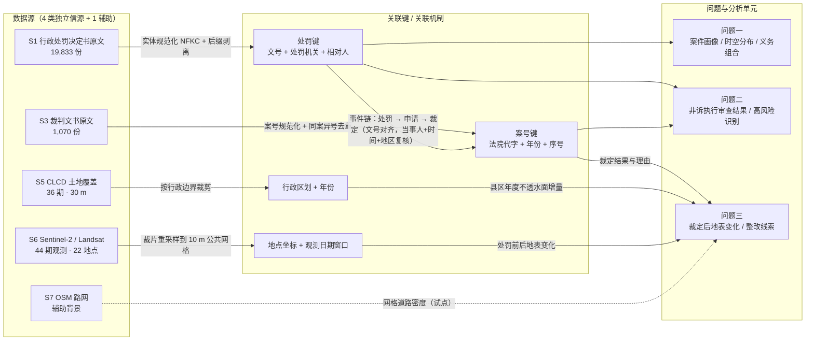
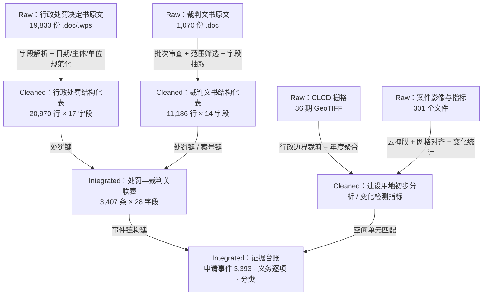

# 多源数据关联图（数据血缘）

> 本图说明四个独立数据源如何通过**实体、事件、时间、空间**四类关联收敛到同一案件分析单元，以及每条关联边的判定依据。
> 图用 Mermaid 编写，GitHub 页面直接渲染；如需 PNG/SVG 插入报告，可用 `mmdc -i docs/多源数据关联图.md -o 关联图.png` 或截图。

## 一、关联拓扑

## 二、数据血缘（Raw → Cleaned → Integrated）

## 三、关联边清单

| 源 → 目标 | 关联维度 | 判定依据 | 代码位置 |
|---|---|---|---|
| S1 → 处罚键 | 实体 | 文号、处罚机关、行政相对人三要素规范化后拼接；同键多行合并并保留 `源表行` | `支撑文件/问题一/lib/normalize.py` |
| S3 → 案号键 | 实体 | 全半角统一、年份括号样式统一、法院代字与序号拆分 | `支撑文件/问题一/lib/court_fields.py` |
| 处罚 ↔ 裁定 | 事件 + 时间 | 裁定文书中援引的处罚决定书文号与处罚表对齐，并以当事人、裁判日期、地区复核；校验 `len(唯一处罚键) == len(关联结果)` | `支撑文件/问题一/lib/ledger.py` |
| 案件 ↔ CLCD | 空间 + 时间 | 案件地市/县区匹配行政区，按年份取对应栅格，统计编码 8 面积 | `支撑文件/问题一/lib/landuse_rules.py` |
| 案件 ↔ 影像 | 空间 + 时间 | 处罚时点及一年后、±90 天窗口选片；裁片重采样到 10 m 公共网格后逐地点比较 | `采集/遥感影像采集/`、`处理/问题三/prepare.py` |
| 案件 ↔ OSM | 空间 | 5 km 网格编号聚合道路密度 | `采集/遥感影像采集/采集脚本_中山/04_extract_osm.py` |

## 四、为什么单一信源不足以回答核心问题

| 问题 | 仅用单一源会得到什么 | 缺了什么 |
|---|---|---|
| 问题一 | 只能得到处罚数量与主体的分布 | 不知道哪些案件真正进入了司法程序、申请与裁定的时间间隔与义务履行结构 |
| 问题二 | 只能得到裁定结果的比例 | 不知道被裁定案件在处罚端的对应特征（违法类型、面积、罚款、义务），无法识别高风险画像 |
| 问题三 | 只能看到地表是否变化 | 不知道变化对应的案件、裁定结果与时间点，无法判断“准予执行后是否整改” |

## 五、关联质量与已知局限

- **实体解析**：主体名存在简称、别名、村委会/经济社与镇政府混写，已用后缀剥离与别名表降低误配，仍无法保证 100% 对齐。
- **事件对齐**：部分裁定文书未直接援引处罚文号，只能靠当事人 + 日期 + 地区推断，这类记录在关联表中标注为候选，未计入确认关联。
- **空间精度**：遥感裁片地址定位精度约 50—200 m（沿用原研究），跨网格边界的案件可能存在归属偏差；CLCD 30 m 分辨率对细碎地块不敏感。
- **时间对齐**：CLCD 为年度产品，处罚与裁定为日粒度，年度聚合会掩盖年内时序；2021 期产品变化幅度异常偏小，断点分析时单独标注。
